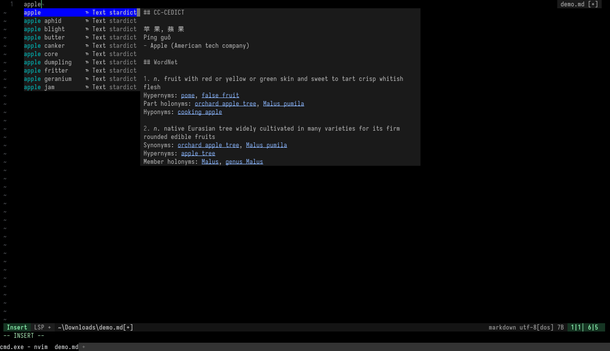
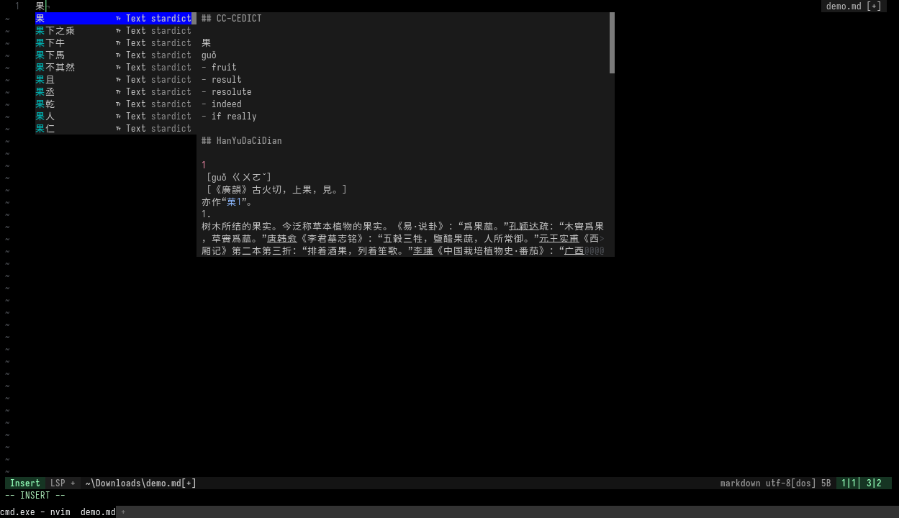

<div align="center" style="display: flex; justify-content: center;">
  
  
</div>

# blink-cmp-stardict

Word completion and definitions from local [StarDict](https://github.com/huzheng001/stardict-3) dictionaries.

Authors: Kimi-K3🧙‍♂️, scillidan🤡

- Instant case-insensitive prefix search over the dictionary's `.idx` index (pure Lua, no `sdcv` binary needed)
- Definitions rendered as markdown in the documentation window
- Handles `sametypesequence=m` (plain / sdcv-style text with ANSI colors, rendered as real highlights) and `h` (HTML → markdown)
- Dictionaries load asynchronously; Neovim never blocks

## Requirements

- Neovim 0.10+
- [blink.cmp](https://github.com/Saghen/blink.cmp)
- StarDict dictionaries (`.ifo` + `.idx` + `.dict`

I'm using the `sdcv` version dictionaries that renders HTML using ANSI escape sequences. Find them [here](https://github.com/scillidan?tab=repositories&q=share_).

## Installation

Using [lazy.nvim](https://github.com/folke/lazy.nvim):

```lua
{
	"saghen/blink.cmp",
	dependencies = { "scillidan/blink-cmp-stardict" },
	opts = {
		sources = {
			default = { "lsp", "path", "stardict" },
			providers = {
				stardict = {
					name = "stardict",
					module = "blink-cmp-stardict",
					opts = {
						-- Default options
						-- Multiple paths supported. Set it for your platform/install method:
						--   Linux: ~/.stardict/dic, /usr/share/stardict/dic
						--   Windows: custom path with your dictionaries
						dict_dirs = {}, -- Required
						include_dictionaries = {}, -- e.g. "CC-CEDICT", "WordNet"
						exclude_dictionaries = {}, -- e.g. "GCIDE"
						ansi_colors = true,
						max_items = 100,
						min_chars = 3,
					},
				},
			},
			per_filetype = {
				text = { "stardict" },
				markdown = { "stardict" },
			},
		},
	},
}
```

## Dictionaries

Only the `.idx` index is kept in memory; definitions are read from `.dict` on demand, so large dictionaries (CC-CEDICT ≈ 500k entries) stay cheap.

## See also

- [blink-cmp-words](https://github.com/archie-judd/blink-cmp-words)
